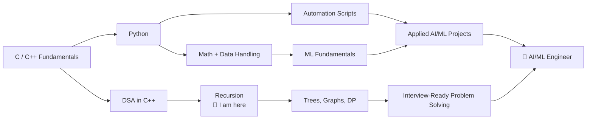

<!--
  Krishna Chaurasiya — GitHub Profile README

  SETUP CHECKLIST
  1) Create a PUBLIC repo named exactly like your GitHub username (e.g. github.com/krishna123/krishna123).
  2) Find & replace Kris05C with your exact username (case-sensitive in some URLs).
  3) Replace YOUR_LINKEDIN_URL and YOUR_EMAIL.
  4) For the snake animation, add the workflow shown at the bottom of this file.
  5) Only list projects you can fully explain in an interview.
-->

<div align="center">


<a href="https://github.com/Kris05C">
  <!-- ✏️ CHANGE HERE (optional): edit the animated tagline. Each line is separated by a semicolon (;) in the URL after "lines=". Use + for spaces, %2C for comma, %2F for "/", %2B for "+". Keep each line short (under ~50 characters). -->
  
</a>

<p>
  
  
  
  <!-- ✏️ CHANGE HERE (optional): this badge says you're open to opportunities. Remove this whole  line if you don't want it, or change the text after /badge/ (use %20 for spaces). -->
  
</p>

</div>

---

## 👨‍💻 About Me

I'm **Krishna Chaurasiya**, a computer science student who wants to understand how things work, not just make them work. My long-term goal is to become a **top-tier problem solver** and build intelligent, reliable software in **AI/ML and automation**.

<!-- ✏️ CHANGE HERE: update the lists inside this Python block as you learn new things (e.g. add "Recursion ✔" or "Trees" to self.learning, move finished items into self.languages). Keep it truthful. -->
```python
class Krishna:
    def __init__(self):
        self.role      = "CSE Student | Aspiring AI/ML Engineer"
        self.languages = ["C", "C++", "Python"]
        self.frontend  = ["HTML5", "CSS", "Bootstrap", "Tailwind CSS"]
        self.learning  = ["DSA (Recursion)", "Python", "Automation", "ML Fundamentals"]
        self.goal      = "Solve hard problems. Build software that matters."

    def daily_routine(self):
        return ["Solve problems", "Write clean code", "Document learnings", "Repeat"]
```

| | |
|---|---|
| 🧠 **Problem solving** | DSA in C++, currently on **Recursion** |
| 💻 **Programming** | C, C++, and learning Python |
| 🌐 **Frontend** | HTML5, CSS, Bootstrap, Tailwind CSS |
| 🤖 **Direction** | AI/ML, intelligent applications, automation |
| 🏗️ **Approach** | Learn a concept → implement it → document it → improve from feedback |

---

## 🧰 Tech Stack

<!-- ✏️ CHANGE HERE: to add a skill, add its icon id in the "i=" list of the matching skillicons.dev URL below (comma separated), e.g. i=c,cpp,python,java. Icon ids: https://skillicons.dev -->


<div align="center">

**Languages**


**Frontend**


**Tools**


</div>

---

## 🧭 Engineering Roadmap

<!-- ✏️ CHANGE HERE: when you finish Recursion, move the "📍 I am here" text in the diagram's node C to your next topic. Also update the Status column (🟢 In progress / 🟡 Ongoing / 🔵 Upcoming) in the table. -->




| Focus area | Current direction | Status |
|---|---|---|
| **DSA & problem solving** | C++ fundamentals → recursion → core data structures & algorithms | 🟢 In progress |
| **Python** | Fundamentals → scripting → automation | 🟢 In progress |
| **Software development** | Responsive frontend projects → stronger engineering practices | 🟡 Ongoing |
| **AI & Machine Learning** | Python, math, data handling → ML basics → applied projects | 🔵 Upcoming |
| **Professional growth** | Git/GitHub, technical writing, communication, interview practice | 🟡 Ongoing |

> This is a learning roadmap, not a claim that every topic is mastered.

---

## 🎯 Current Focus

<!-- ✏️ CHANGE HERE: keep these bullets in sync with what you're actually studying right now. Replace finished items with new ones. -->


- 🔁 **Recursion in C++**: base cases, recursion trees, backtracking intuition
- 🐍 **Python fundamentals**: data structures, file handling, small automation scripts
- 🌐 **Responsive UI**: cleaner layouts with Bootstrap and Tailwind CSS
- 📝 **Documenting what I learn**: approach, time and space complexity, lessons learned

---

## 🚀 What I'm Building Towards

| Project type | What it will demonstrate |
|---|---|
| ⚙️ **Automation tools** | Scripts that remove repetitive work and save real time |
| 🤖 **AI/ML applications** | A clearly defined problem, data, method, evaluation, limitations |
| 🛠️ **Developer utilities** | Small tools that improve productivity |
| 🧩 **DSA solutions** | Well-explained C++ solutions with complexity analysis |
| 🖥️ **Full projects** | A useful interface connected to sound logic and, later, intelligent features |

---

## 📌 Featured Projects

<!--
  ✏️ CHANGE HERE: in the table below, replace each "add link" / "Add link when ready" with a real repo link like [View repo](https://github.com/Kris05C/REPO-NAME), and change the Status column (🚧 In progress / ✅ Done / 🔵 Planned) when the project is finished. Rename or delete rows for projects you don't have. List ONLY projects you can explain fully in an interview.
  Recruiters check repos. A few honest, well-documented projects beat many empty ones.
-->

| Project | Description | Tech | Status |
|---|---|---|---|
| **DSA-in-CPP** | Solutions with approach, time/space complexity, and notes | `C++` | 🚧 In progress → [add link](https://github.com/Kris05C) |
| **Responsive Web Project** | Mobile-first site with clean UI and good structure | `HTML` `CSS` `Bootstrap` `Tailwind` | 📝 Add link when ready |
| **Python Automation Script** | A working script with setup instructions and a short demo | `Python` | 📝 Add link when ready |
| **First ML Project** | Problem → data → model → results → limitations | `Python` | 🔵 Planned |

---

## 📊 DSA Progress Tracker

<!-- ✏️ CHANGE HERE: update each topic's status as you progress (⚪ Upcoming → 🟢 In progress → ✅ Done). You can also add a column like "Problems solved" with your real count. -->


| Topic | Status |
|---|---|
| Arrays & Strings | 🟡 Update status |
| Recursion | 🟢 In progress |
| Searching & Sorting | ⚪ Upcoming |
| Linked Lists, Stacks, Queues | ⚪ Upcoming |
| Trees & Graphs | ⚪ Upcoming |
| Dynamic Programming | ⚪ Upcoming |

---

## 📈 GitHub Stats

<!-- ✏️ NOTE: these cards show real data from the username Kris05C, so they look empty at first. To count private work too, turn on "Private contributions" in your GitHub profile settings. No code change needed here unless you change your username. -->


<div align="center">


</div>

### 🐍 Contribution Snake

<!-- ✏️ ACTION NEEDED: this image stays broken until you add the workflow file from the comment at the very bottom of this README (.github/workflows/snake.yml) and run it once from the repo's Actions tab. No edit needed in this section itself. -->


<div align="center">

<picture>
  <source media="(prefers-color-scheme: dark)" srcset="https://raw.githubusercontent.com/Kris05C/Kris05C/output/github-snake-dark.svg" />
  <source media="(prefers-color-scheme: light)" srcset="https://raw.githubusercontent.com/Kris05C/Kris05C/output/github-snake.svg" />
  
</picture>

</div>

---

## 💡 Principles I Work By

- **Fundamentals first.** Strong basics beat shallow tool-hopping.
- **Build to learn.** Every concept becomes code, and every project gets documented.
- **Consistency over intensity.** Small daily progress compounds.
- **Write for the reader.** Clear READMEs, clean commits, readable code.

---

## 🤝 Let's Connect

<div align="center">

<a href="https://github.com/Kris05C"></a>
<!-- ✏️ CHANGE HERE (required): replace YOUR_LINKEDIN_URL with your full LinkedIn profile link, e.g. https://www.linkedin.com/in/your-id -->
<a href="https://www.linkedin.com/in/krishna-chaurasiya-2a2540383"></a>
<!-- ✏️ CHANGE HERE (required): replace YOUR_EMAIL with your real email address, e.g. mailto:name@gmail.com -->
<a href="mailto:chaurasiyakrishn05@gmail.com"></a>

<br/><br/>

<i>Think deeply. Solve systematically. Build responsibly. Keep learning.</i>


</div>

<!--
  SNAKE WORKFLOW — save as .github/workflows/snake.yml in your profile repo:

  name: Generate Snake
  on:
    schedule:
      - cron: "0 0 * * *"
    workflow_dispatch:
  permissions:
    contents: write
  jobs:
    generate:
      runs-on: ubuntu-latest
      steps:
        - uses: Platane/snk/svg-only@v3
          with:
            github_user_name: ${{ github.repository_owner }}
            outputs: |
              dist/github-snake.svg
              dist/github-snake-dark.svg?palette=github-dark
        - uses: crazy-max/ghaction-github-pages@v3.1.0
          with:
            target_branch: output
            build_dir: dist
          env:
            GITHUB_TOKEN: ${{ secrets.GITHUB_TOKEN }}
-->
